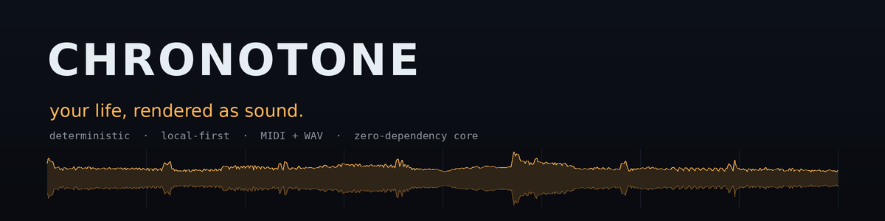
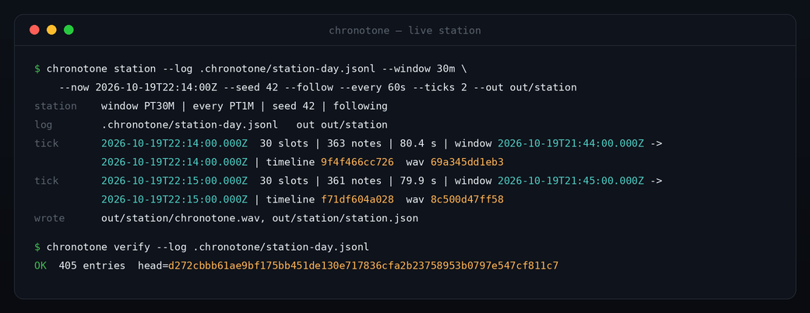
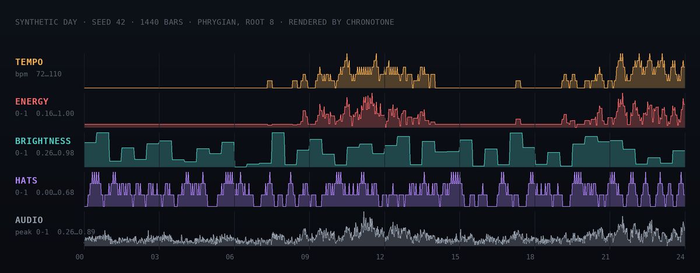
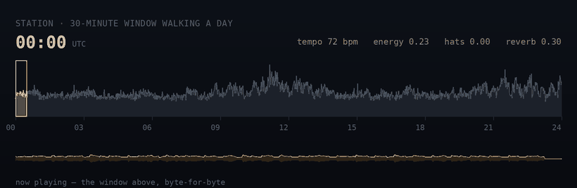
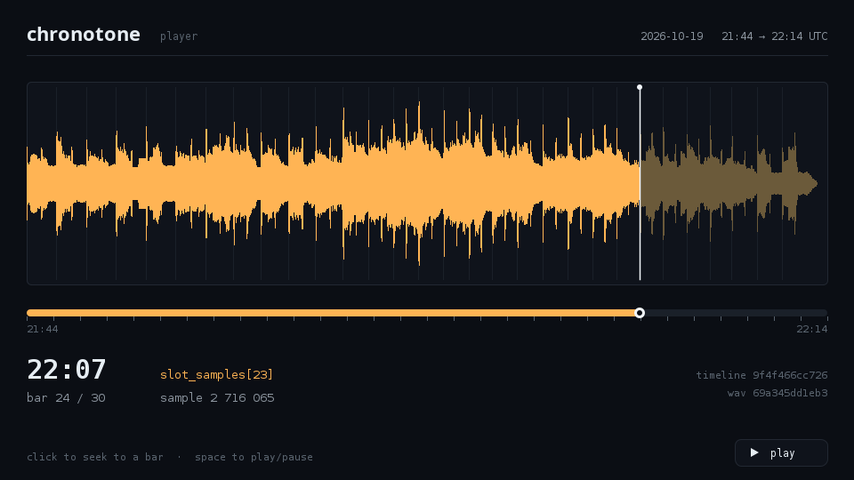

<p align="center">
  <a href="https://github.com/dhananjay-nautiyal/chronotone/actions/workflows/ci.yml"></a>
  
  
  
</p>

Chronotone turns a window of your digital life — commits, scrobbles, weather, steps — into an
original, continuous piece of music. Scrub back to any moment and hear that exact moment again.
At the end of a day (or a month, or a year) you get a finished track.

This is not a generative-music toy. The core idea is the **determinism contract**:

> A render is a pure function of `(events, seed, mapping, grid)`. Same inputs, same audio, same hash.

That one constraint changes what the project can be:

| Consequence | What it enables |
| --- | --- |
| Reproducible audio | The timeline becomes *navigable*, not random. A moment always sounds the same. |
| Content addressing | Every render has a `sha256`. Share the hash, keep the events private. |
| Tamper-evident history | The log is a hash chain, and a **Merkle root** over any slice can be published while the events stay private. |
| CI-verifiable art | Two renders of the same day must be byte-identical, and CI enforces it. |

## A session

`station` keeps a trailing window of the log and re-renders it as the clock moves. This is real
output, not a mock-up:



Every tick prints `timeline` and `wav` digests, and `verify` walks the whole hash chain. Both hashes
are of artifacts you can reproduce byte for byte from the same log and seed.

## One day, as music

Five musical dimensions, sampled once per bar across a whole day. Every curve is a value the engine
actually produced for the deterministic synthetic day (`seed 42`):



And this is what "listening live" means — a 30-minute window walking across that same day, with the
window's own waveform below it:



The GIF is silent, which is a shame for an audio project — the Quickstart below plays the real thing.
Every image on this page is generated from the engine's own output by
[`docs/generate_assets.py`](docs/generate_assets.py); the charts use the synthetic day and never
anyone's real log.

## Status

Phases 1–5 and 6a of the roadmap are complete and working:

- Append-only, tamper-evident **event log** (canonical JSON + hash chain, zero dependencies)
- **Connector SPI** plus a deterministic synthetic connector for demos and CI
- **Connectors that read real life**: your local git history, CSV/JSONL data exports you already
  own, and historical weather from Open-Meteo (no API key)
- **`sync`**: incremental via per-connector watermarks, idempotent via content identity, with a
  dry-run mode that touches nothing
- **Mapping DSL** (YAML): window an event source, aggregate it, map the aggregate into a musical dimension
- **Deterministic renderer**: timeline → note score → Standard MIDI File *and* a self-contained
  44.1 kHz PCM WAV written by a small built-in synth (no audio libraries, no soundfont downloads)
- **Merkle commitments**: publish a root over a day, prove one entry is inside it, and verify that
  proof from two small JSON files without the log
- **Live station mode**: the trailing window is re-rendered as the clock moves, by an incremental
  synth that is sample-exact with the batch one — a live frame is byte-identical to the render of
  the same window, and it can stream straight into a player
- **Player**: a Kotlin Multiplatform navigator that seeks a rendered frame by the engine's published
  sample offsets — a Swing desktop player and a Compose Android app — and never reads your event log
- **Album export**: a month of days as one mastered album — a single gain across every track, five
  stems per day, and a manifest that carries each day's Merkle root
- **Timeline fingerprint**, `sha256` of the MIDI and WAV, and a chain `verify` command
- CLI: `init`, `demo`, `sync`, `render`, `album`, `station`, `commit`, `prove`, `check`, `verify`

## Quickstart

Requires JDK 21 and Maven.

```bash
mvn -B verify                                   # build + tests

mvn -B -ntp package -DskipTests
JAR=$(ls chronotone-cli/target/chronotone-cli-*.jar | grep -v original | head -n1)

# 1. Write a deterministic synthetic day (git commits, scrobbles, weather, steps)
java -jar "$JAR" demo --log .chronotone/demo.jsonl --seed 42

# 2. Render 30 minutes of it, starting at 07:00
java -jar "$JAR" render --log .chronotone/demo.jsonl \
  --from 07:00 --minutes 30 --seed 42 --out out

# 3. Listen
ffplay -autoexit out/chronotone.wav

# 4. Prove the history was not edited
java -jar "$JAR" verify --log .chronotone/demo.jsonl
```

Listen to the same minute twice and compare the hashes: they will be identical.

### Listening live

`station` keeps a trailing window of the log and re-renders it as the clock moves, so you can listen
to today while it is still happening instead of waiting for the end of the day.

```bash
# The last 30 minutes, ending on the current minute boundary
java -jar "$JAR" station --log .chronotone/demo.jsonl --window 30m --out out/station

# Keep it up, and pipe the audio straight into a player: raw 16-bit PCM, mono, 44.1 kHz
java -jar "$JAR" station --log .chronotone/demo.jsonl --follow --every 60s --stream \
  | ffplay -f s16le -ar 44100 -ac 1 -
```

Two things are worth knowing, and CI checks both:

- **A frame is the same bytes as a `render` of the same window.** The window always ends on a grid
  boundary, so slots follow the wall clock, and `station --now <iso>` is a pure function — pin it and
  the `wav_sha256` in `out/station/station.json` never changes. That manifest also records
  `slot_samples`, the sample offset of every slot boundary, so a consumer can seek inside a frame
  without re-deriving the tempo itself.
- **Going live costs no fidelity.** The synth runs one slot at a time (`StreamingSynth`), carrying the
  reverb's delay lines instead of buffering the whole session, and it produces the very same samples
  the batch renderer would. That equality is asserted sample-for-sample in the tests.

`--stream` writes only the slots that have closed since the last tick, and each of those blocks is
byte-identical to the batch render of the window that produced it. Status lines go to stderr, so
stdout stays pure PCM. With `--now` pinned, `--follow --every 60s --ticks 3` is a deterministic
three-frame run — which is exactly how CI exercises it.

### A month, as an album

A day is a track; a month is an album. The difference is not the file count — it is that an album is
mastered as a whole. `render` and `station` have to pick a gain before their material has finished
existing, so each masters its own window. An album knows all of its days before it writes any of
them, so it renders them twice: once to find the month's peak, once to write, scaling every track by
that same factor.

```bash
# Every day of the month is a track (days with no entries are listed, not rendered)
java -jar "$JAR" album --log .chronotone/demo.jsonl --month 2026-10 --seed 42 --out out/album

# The same album plus five stems per track: pad, bass, lead, kick, hat
java -jar "$JAR" album --log .chronotone/demo.jsonl --month 2026-10 --stems

# An album of mornings, or of a few days — --window and --start shape each day
java -jar "$JAR" album --from 2026-10-19 --days 5 --start 07:00 --window 10m --stems
```

Five synthetic days (seeds 42–46), ten minutes of each morning, with stems:

```
album      chronotone.album/1
range      2026-10-19 .. 2026-10-23  (5 days requested)
window     07:00 + PT10M per day
mapping    v1.0 ([tempo, energy, brightness, hatDensity, reverbWet])
tracks     5 with sound
mastering  one gain for the album, peak 0.89
audio      0:02:51.161 at 44.1 kHz / 16-bit / mono

2026-10-19      3 events     10 bars      90 notes  0:00:35.333  8fe9ccb7ad25  root 1d7c71c1eb8c
2026-10-20      3 events     10 bars     100 notes  0:00:35.333  7707f4123a2e  root f4bb46d072df
2026-10-21      4 events     10 bars     110 notes  0:00:35.333  145004deb60b  root c0aa03a03385
2026-10-22      5 events     10 bars     110 notes  0:00:29.828  c5d1bda5d032  root 1abe07114328
2026-10-23      3 events     10 bars      90 notes  0:00:35.333  5b9f1702bf16  root bb94746ff8e5

stems      pad, bass, lead, kick, hat per track, same gain as the album
wrote      out/album/album.json, out/album/tracks (5 files), out/album/stems
```

```
out/album/
  album.json               # the manifest: one entry per day, each with its Merkle root
  tracks/2026-10-19.wav    # a day, at the album's gain
  stems/2026-10-19/        # pad.wav, bass.wav, lead.wav, kick.wav, hat.wav
```

What makes it an album rather than a folder:

- **One gain.** The album's loudest sample is exactly the album peak (`0.89` of full scale) and every
  track is scaled by the same factor, so a quiet Tuesday stays quieter than a loud Saturday. CI asserts
  that peak and, in the tests, that a one-day album is byte-identical to `render` of the same window.
- **Each track closes its day.** Every entry in `album.json` carries the Merkle root and chain head of
  the log entries that track was made from. Publishing an album publishes a commitment to the whole
  month, track by track, without publishing a single event.
- **Stems add back up.** The five voices are rendered separately, each with the day's reverb applied to
  that stem alone. Reverb is linear, so the stems sum back to the track to within one
  least-significant bit per stem — no hidden voice, no invented residual.
- **Nothing holds a month in memory.** Each day is synthesised block by block by `StreamingSynth`;
  only the block being written exists at any moment. Days with no entries are skipped and named under
  `empty_days` in the manifest.
- **The cost is honest.** A day compresses 24:1, so a full-day track is about an hour of audio
  (~340 MB of uncompressed WAV) and a 31-day album is ~33 hours and ~10 GB. That is why `--window`
  exists: "the mornings" is a smaller, and often better, album.

### Commitments


The chain and the Merkle tree answer different questions. The chain proves *nothing in this log was
edited*, but checking it needs every byte. A commitment lets you publish a root and later prove one
event is inside it — without disclosing the rest.

```bash
java -jar "$JAR" commit --day 2026-10-19 --out out/commitment.json    # publish this file
java -jar "$JAR" prove  --commitment out/commitment.json --index 4 --out out/proof.json
java -jar "$JAR" check  --commitment out/commitment.json --proof out/proof.json
java -jar "$JAR" verify --commitment out/commitment.json              # log still matches?
```

`check` reads only those two files: no log, no other entries, no payloads. For 24 committed entries
the proof is 5 hashes.

Why both? Because a hash chain alone cannot detect a *re-hashed rewrite*. If someone edits an event
and recomputes every hash after it, the chain is internally consistent and `verify --log` says `OK`.
Sending that forged log against a commitment published earlier makes it fail:

```
$ java -jar "$JAR" verify --log forged.jsonl                     # chain recomputed by the forger
OK  24 entries  head=ad66d30742a8...

$ java -jar "$JAR" verify --log forged.jsonl --commitment out/commitment.json
FAILED  the log does not match this commitment
```

### With your own data

Nothing personal ever goes into this repository — connectors run locally and write to a log that
stays on your disk. `examples/connectors.yaml` is a working config you can copy and edit:

```bash
cp examples/connectors.yaml .chronotone/connectors.yaml     # then point it at your own exports

java -jar "$JAR" sync --config .chronotone/connectors.yaml --dry-run   # see what would be added
java -jar "$JAR" sync --config .chronotone/connectors.yaml             # append it
java -jar "$JAR" render --from 07:00 --minutes 100 --out out
java -jar "$JAR" verify
```

## The player



The player is a **navigator, not a second synthesizer**.

Porting the synth to Kotlin would mean two implementations that must agree forever, and the
determinism contract is the one thing this project cannot afford to fork. So the phone is given two
files — `chronotone.wav` and `station.json` — and nothing else. It never sees the event log, the
mapping, or a timestamp of your life.

Seeking is exact because the engine publishes where every bar begins:

```
slot_samples[0 .. slots+1]   # start of each bar, then the last bar's end, then the tail's end
```

Click the waveform and the player maps that instant to the bar containing it and starts at
`slot_samples[bar]` — the engine's own sample offset, not a re-derived tempo. The readout names the
field it used, so the claim is checkable while you listen.

```bash
cd player

# Desktop reference player (Swing, nothing beyond the JDK)
./gradlew :desktopApp:run --args="--station ../out/station"

# Paint it without a display — the same code the window runs
./gradlew :desktopApp:run --args="--station ../out/station --slot 23 --screenshot player.png"

# Android: build, install, then push a frame to the device
./gradlew :androidApp:assembleDebug
adb install androidApp/build/outputs/apk/debug/androidApp-debug.apk
adb push ../out/station/station.json   /sdcard/Android/data/dev.chronotone.player/files/frame/
adb push ../out/station/chronotone.wav /sdcard/Android/data/dev.chronotone.player/files/frame/
```

`shared` is Kotlin Multiplatform (`jvm` + `androidTarget`); the file and PCM layer sits in a
`jvmSharedMain` source set that both UIs consume, so "read a frame from disk" exists once. The module
has no dependencies — its JSON reader, ISO-8601 handling and seek math are its own — and the manifest
parser is strict on purpose: a frame whose boundaries do not add up is refused rather than
half-played.

CI checks the two languages against each other on every run. It regenerates the frame that
`player/shared/src/jvmTest/resources/station.json` came from, `diff`s the manifest byte for byte, then
runs the Kotlin tests over it. If the renderer's geometry ever moves, the player's fixture fails.

## Connectors

A connector turns one source of your life into events. Adding a source is a config entry, not code.

| Type | Reads | Options |
| --- | --- | --- |
| `git` | your local commit history via `git log --numstat` | `repo` |
| `file` | any CSV or JSONL export you already have (health, listening history, habits) | `path`, `format`, `time_column`, `time_format`, `payload` |
| `open-meteo` | historical hourly weather (keyless public API) | `latitude`, `longitude` |
| `synthetic` | a deterministic fake day, for tests and demos | `seed` |

```yaml
connectors:
  - id: git
    type: git
    repo: ~/projects/chronotone
  - id: scrobbles
    type: file
    path: ~/exports/scrobbles.csv
    format: csv
    time_column: played_at
    time_format: iso          # iso | epoch_s | epoch_ms | <pattern>
    event_source: music
    event_type: scrobble
    payload: artist,track,duration_s
```

**Privacy.** Events are produced on your machine and appended to a local log. The only network call
in the whole project is the weather connector, which sends a latitude and a longitude and nothing
else. The engine is public; your life is not.

**Sync is safe to re-run.** A watermark per connector means the next sync only asks for new time,
and an event's identity is `sha256(connectorId + canonical event)`, so overlapping windows cannot
duplicate history. Deleting the watermarks entirely still appends nothing twice.

## How a day becomes music

```
connectors (git, scrobble, weather, health)
      └─► event log        append-only, hash-chained, canonical JSON
              └─► mapping DSL    window + aggregate + range  ──►  musical params per slot
                      └─► score builder    params ──► notes (PPQ 480)
                              ├─► SMF writer     ──► chronotone.mid
                              └─► synth ─────────► chronotone.wav     (a whole window at once)
                                      └─ StreamingSynth ──► live PCM   (one slot at a time, same samples)
```

A mapping is data, not code:

```yaml
mapping: v1.0
grid: 1m                 # one slot == one bar

params:
  tempo:
    events: { source: git, type: commit }
    window: 10m
    aggregate: { kind: count }
    in: [0, 8]           # raw count  ->  normalised 0..1
    out: [72, 132]       # normalised ->  BPM

  brightness:
    events: { source: weather, type: sample }
    window: 30m
    aggregate: { kind: mean, field: cloud_cover }
    in: [0.0, 1.0]
    out: [1.0, 0.25]     # overcast dulls the pad, clear sky opens it up
```

Musical parameters: `tempo`, `energy`, `brightness`, `hatDensity`, `reverbWet`.
Key and mode are derived deterministically from the mapping's `seed_salt` and the day,
so a day has its own tonal identity. See `chronotone-dsl/src/main/java/dev/chronotone/dsl/DefaultMapping.java`.

## Modules

| Module | Responsibility | Dependencies |
| --- | --- | --- |
| `chronotone-core` | `Event`, canonical JSON, JSON reader, hash chain, `EventLog`, Merkle tree/proofs/commitments, connector SPI | **none** |
| `chronotone-dsl` | Mapping DSL: parse, validate, evaluate | core, SnakeYAML |
| `chronotone-render` | Timeline, score builder, MIDI writer, PCM/WAV synth, incremental `StreamingSynth`, live `Station`, album mastering | core, dsl |
| `chronotone-connectors` | git history, CSV/JSONL exports, Open-Meteo weather, incremental sync | core, SnakeYAML |
| `chronotone-cli` | `init` / `demo` / `sync` / `render` / `album` / `station` / `commit` / `prove` / `check` / `verify` | all |
| `player/` | Kotlin Multiplatform player: manifest contract, seek math, headless screenshot, Swing + Compose UIs | **none** in `shared` |

## Determinism rules

The renderer only uses `StrictMath` (portable IEEE-754 results), `java.util.Random` (a specified
algorithm) seeded from a mixing function of `(seed, slot)`, and integer ticks — no wall-clock time,
no hash-map iteration order, no float accumulation across threads. The render manifest deliberately
contains no timestamp so that two renders can be `diff`ed in CI.

The incremental synth keeps that promise without any new state: it visits voices in the order the
score produced them (floating-point addition is not associative, so summation order is part of the
contract) and carries the reverb's feedback delay lines across block boundaries. A block split only
decides *when* samples are produced, never which samples they are.

`station` is the one command that reads the clock, and it reads it for a single purpose: choosing the
window. Pin `--now` and everything downstream is a pure function of the inputs again.

Album mastering adds no new state either. The gain is the peak of the same day mixes the tracks are
written from, computed by the same synth, which is why a one-day album is byte-identical to `render`
of that day — asserted in the tests, not just claimed here.

## Roadmap

| Phase | Scope | State |
| --- | --- | --- |
| **1** | Event log, connector SPI, mapping DSL, deterministic MIDI + WAV render, CLI, CI | ✅ |
| **2** | Real connectors (git, CSV/JSONL exports, Open-Meteo weather), incremental idempotent sync | ✅ |
| **3** | Merkle commitments: publish a root, prove inclusion, verify without the log | ✅ |
| **4** | Live station mode: an incremental, sample-exact synth; a rolling window rendered as the clock moves; raw-PCM streaming | ✅ |
| **5** | Android/KMP player with timeline scrubbing | ✅ |
| **6a** | Album export: day-close manifest, per-day tracks, one gain for the whole album, per-day stems | ✅ |
| **6b** | Generative cover art and share card | planned |

Phase 4 deliberately stops short of "commit the day" — the day-level commitment is already `commit`,
so a station needs a *day-close* step rather than a new artifact. The album export is that step: each
track in `album.json` carries the commitment of the day it was rendered from.

## Honest limitations

Merkle commitments close the biggest gap, but not every one. Still true today:

- **The commitment is checked against a log you hold.** A commitment binds you to a history; it does
  not prove the history is *complete*, or that events were not withheld.
- **Proofs are inclusion-only.** There is no non-inclusion proof, so "this event was in the day" is
  provable and "this event was not" is not.
- **Event timestamps and source/type are public** in a commitment's scope description. The payloads
  are what stays private.
- **A tree over 24 entries is small.** Anything short of a full privacy design (padding, hiding the
  slice size) leaks the number of events and their rough times.
- **A station is a rolling window, not a gapless stream.** It re-masters its window on each tick and
  emits every closed slot once, so the blocks are sample-exact but gain is normalised per window and
  can step slightly from tick to tick. The master of a whole day is still `chronotone render`.
- **The player plays; it does not render.** A frame is produced by the CLI and copied to the device.
  Rendering on the phone would mean a second engine to keep in agreement, which is exactly what the
  design avoids — so the phone holds audio and a manifest, never an event.
- **The Android app is compiled in CI, not run.** There is no emulator in the pipeline: the screen is
  covered by the shared tests and the desktop paint test, not by a device test.
- **A station cannot hear the future.** A slot is played once it closes, so an event that arrives
  later is not retroactively inserted into what you already heard. Re-rendering the same `--now`
  does include it, because a frame is a pure function of the log.
- **An album is big and slow on purpose.** A full day is ~340 MB of uncompressed WAV and the album
  synthesises each day twice (once for the peak, once to write), so a 31-day album is ~10 GB and about
  an hour of CPU. `--stems` multiplies the output by five. `--window` is the honest way to keep an
  album small.
- **A skipped day is a decision, not silence.** A day with no entries inside the window is named under
  `empty_days` instead of becoming an hour of nothing. That keeps a sparse month listenable and keeps
  the album a pure function of the log.
- **"Mastered" means one gain, nothing more.** The album is peak-normalised as a whole; there is no
  compression, EQ or limiting, so it will sound quieter than a commercial record.
- **The synth is deliberately plain.** The WAV is clean and listenable, not polished.

## License

MIT — see [LICENSE](LICENSE).
